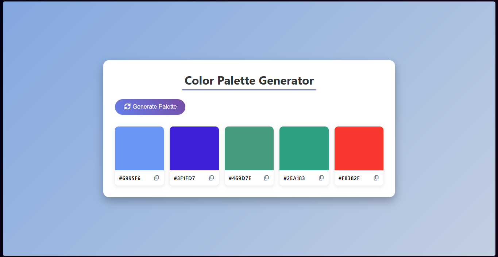
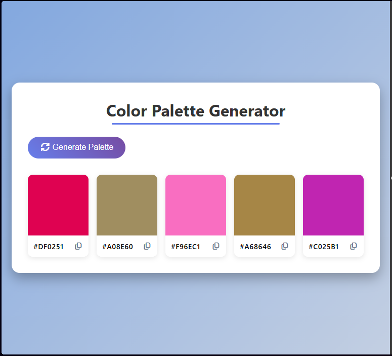
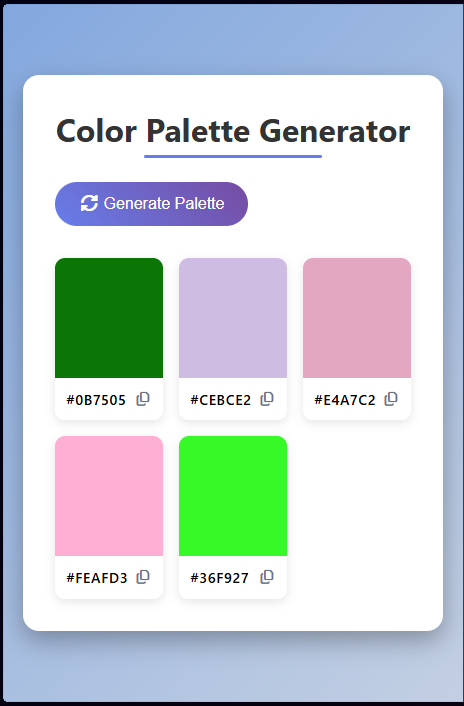
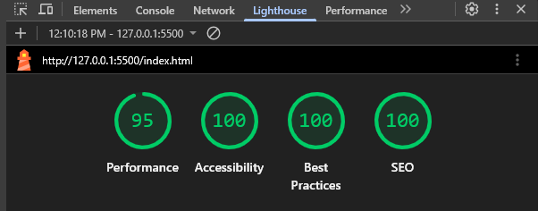

# 🎨 Color Palette Generator

Generate beautiful color palettes in seconds. Whether you're designing a website, creating a brand identity, or simply looking for inspiration, this tool helps you discover and experiment with harmonious color combinations.

## Features

- 🎲 Generate random color palettes
- 📋 Copy HEX color values with a single click
- 🌈 Clean and responsive interface
- ⚡ Fast and lightweight
- 📱 Works on desktop and mobile devices

## Project Preview

<table>
  <tr>
    <td colspan="2">
      
    </td>
  </tr>

  <tr>
    <td>
      
    </td>
    <td>
      
    </td>
  </tr>
</table>

## Tech Stack

- HTML
- CSS
- JavaScript

## Performance Metrics
These were the performance metrics during development

---